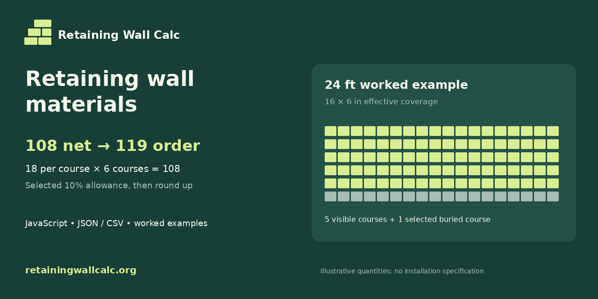

# Retaining Wall Materials



A dependency-free JavaScript library and command-line tool for selected retaining-wall material quantities. It counts full block courses, selected buried courses, cap stones, separate base and drainage stone volumes, and optional full-package purchases. Imperial and metric inputs have explicit units.

**Quantity estimates only.** This toolkit does not check structural stability, choose embedment or reinforcement, design drainage or approve an installation. Use actual product coverage and approved project dimensions.

## Run a worked example

Use Node.js 22 or 24. No installation, account, API key or network access is required after downloading the source.

```bash
node cli.mjs examples/imperial-24ft.json
node cli.mjs examples/metric-7-2m.json
node cli.mjs examples/imperial-24ft.json --format csv
npm test
```

This repository is not an npm-published package. Its `private: true` flag prevents accidental npm publication. Import the local module or run the CLI from the repository root.

## The 24 ft example

Selected inputs: 24 ft run, 30 in exposed block-course height excluding caps, 16×6 in effective block coverage, one buried course and a 10% block allowance.

| Quantity | Calculation | Result |
|---|---|---|
| Blocks per course | 288 in ÷ 16 in | 18 |
| Visible courses | 30 in ÷ 6 in | 5 |
| Visible blocks | 18 × 5 | 90 |
| Selected buried blocks | 18 × 1 | 18 |
| Net blocks | 90 + 18 | 108 |
| Order with allowance | 108 × 1.10 = 118.8, round up | **119** |
| Whole packages, if required | 2 packages × 75 units | **150 supplied**, 31 above the 119 order |

The package quantity is an alternative purchasing increment; it is not added to the required order. Caps are counted separately: 18 net and 20 with the selected 10% cap allowance.

For selected stone geometry, the example uses a 22 in **total** base width and 6 in depth: 22 ft³ net, about 0.90 yd³ after the 10% stone allowance. Its drainage width is 12 in and the selected zone height is 2.5 ft, with zero core fill: 60 ft³ net, about 2.44 yd³ after allowance. These dimensions are hypothetical inputs, not installation requirements.

## Metric example

`examples/metric-7-2m.json` uses a 7.2 m run, 0.8 m exposed block height, 400×200 mm effective coverage, one selected buried course and 10% allowance: **72 visible → 90 net → 99 order blocks**. It is a separate hypothetical product/project, not a rounded conversion of the 24 ft example.

## Use the API

```javascript
import { readFileSync } from 'node:fs';
import { estimateProject, materialListCsv } from './src/index.mjs';

const input = JSON.parse(readFileSync('examples/imperial-24ft.json', 'utf8'));
const result = estimateProject(input);
console.log(result.blocks.order); // 119
console.log(materialListCsv(result));
```

See [API and input units](docs/api.md), [formulas and limits](docs/methodology.md) and the [worked examples](docs/worked-examples.md). Complete expected JSON outputs and a material CSV are included alongside their inputs. A [supplier quote worksheet](examples/supplier-quote-worksheet.csv) keeps product, quantity and selling unit visible without inventing prices.

## Related web tools

- [Block calculator](https://retainingwallcalc.org/calculators/block-calculator?utm_source=github&utm_medium=referral&utm_campaign=launch_2026_10&utm_content=readme_blocks)
- [Gravel and drainage calculator](https://retainingwallcalc.org/calculators/gravel-drainage-calculator?utm_source=github&utm_medium=referral&utm_campaign=launch_2026_10&utm_content=readme_stone)
- [Website formulas and assumptions](https://retainingwallcalc.org/methodology-and-formulas?utm_source=github&utm_medium=referral&utm_campaign=launch_2026_10&utm_content=readme_formulas)

The toolkit implements the documented subset above. It is a separate resource; it does not include the website application, pricing, project sharing, fabric/pipe/adhesive quantities or design checks. Runtime code makes no external requests. Related website links carry placement labels for referral measurement.

## Feedback and reuse

For a calculation issue, include minimal JSON input and the expected count or volume. Read [CONTRIBUTING.md](CONTRIBUTING.md) before sending a pull request. Keep examples free of personal site details.

Code and documentation: [MIT license](LICENSE). Brand artwork has a separate [asset notice](assets/NOTICE.md).
